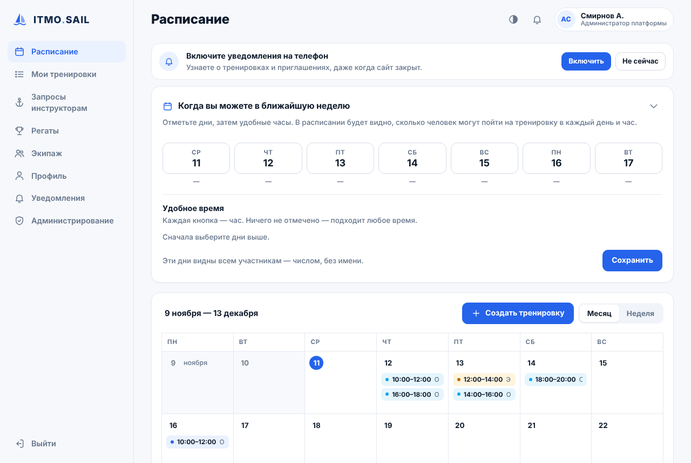
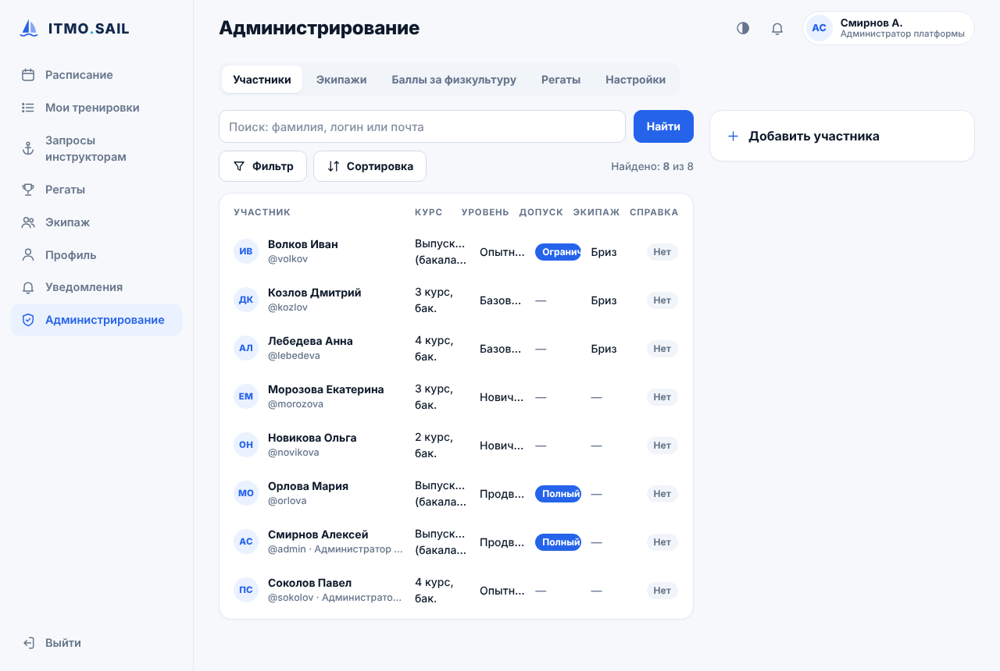

# ITMO.SAIL — запись на тренировки парусной секции

Веб-приложение для студенческой парусной секции: расписание тренировок, запись лично и экипажем, работа инструкторов, регаты и отчёт по баллам за физкультуру. Работает в браузере и устанавливается на телефон как приложение (PWA).

**Демо:** https://itmosail.infy.click (рабочий сайт секции, вход только для участников; на скриншотах вымышленные данные)



| Администрирование | Мобильная версия |
|---|---|
|  |  |

## Что умеет

- **Расписание** на 5 недель вперёд (месяц / неделя), опрос «когда вы можете»: в расписании видно, сколько человек свободно в каждый день и час.
- **Три типа тренировок**: открытая, для своего экипажа и самостоятельная тренировка экипажа. Автоматический добор людей и поиск инструктора, если кто-то отказался.
- **Роли и допуски**: участник, инструктор, администратор, главный администратор; уровни подготовки и допуски экипажей к самостоятельному выходу.
- **Регаты**: регистрация участников, родные и сборные экипажи.
- **Отчёт «Баллы за физкультуру»** по отметкам посещения с выгрузкой в CSV для Excel.
- **Push-уведомления** (Web Push, шифрование RFC 8291 и подпись VAPID реализованы вручную, без сторонних библиотек), офлайн-страница через Service Worker.
- **Загрузка документов** участников (медицинские справки) со сроком действия.

## Технологии

PHP 8 без фреймворков · MySQL (на хостинге) / SQLite (локально) · PDO с подготовленными запросами · ванильный JavaScript · CSS · PWA (Service Worker, Web App Manifest, Web Push). Защита: хэширование паролей, CSRF-токены, токены «запомнить меня» по схеме selector/validator, закрытые от веба каталоги `inc/` и `storage/`.

## Быстрый запуск локально

```bash
cd htdocs
cp inc/config.sample.php inc/config.php   # поменять DB_DRIVER на 'sqlite'
cd .. && php tools/demo_seed.php           # вымышленные демо-данные, вход admin / demo12345
cd htdocs && php -S 127.0.0.1:8080
```

---

## Развёртывание

Платформа рассчитана на бесплатный хостинг InfinityFree (PHP + MySQL). Работает как сайт и как приложение (PWA): на телефоне сайт можно добавить на главный экран.

## Установка на InfinityFree

1. **Создайте хостинг-аккаунт** в клиентской панели InfinityFree. Лучше отдельный от уже существующего проекта, чтобы лимиты и возможные блокировки не затронули оба проекта. Выберите бесплатный поддомен, например `itmo-sail.rf.gd`.
2. **HTTPS** на бесплатных поддоменах InfinityFree включён автоматически, заказывать сертификат не нужно. Сайт сам перенаправляет http на https.
3. **Создайте базу данных**: Control Panel (VistaPanel) → *MySQL Databases* → создайте базу, например `sail`. Запишите четыре значения: *MySQL Hostname* (`sqlXXX.infinityfree.com`), *MySQL Username* (`if0_…`), *MySQL Password* (это пароль хостинг-аккаунта) и полное имя базы (`if0_…_sail`).
4. **Настройте подключение**: скопируйте `htdocs/inc/config.sample.php` в `htdocs/inc/config.php` и впишите туда данные из шага 3. Значение `DB_DRIVER` должно остаться `'mysql'`.
5. **Загрузите файлы**: всё содержимое папки `htdocs/` (а не саму папку) нужно положить в папку `htdocs` на хостинге. Подойдёт *Online File Manager* в панели или FTP-клиент, например FileZilla (данные для подключения есть в разделе *FTP Details*).
6. **Запустите установку**: откройте `https://ваш-домен/install.php`. Будут созданы таблицы и аккаунт главного администратора.
7. **Удалите `install.php`** с хостинга. Он и так блокируется после первой установки, но лишний файл лучше не оставлять.

## Роли

| Кто | Что может |
|---|---|
| Участник | Записываться на тренировки лично и экипажем, состоять в родном экипаже, загружать документы, регистрироваться на регаты |
| Инструктор (личный допуск ≥ 1) | Всё, что участник, плюс создавать открытые тренировки и тренировки для своего экипажа, брать тренировки из «Запросов инструкторам», подтверждать проведение |
| Администратор | Всё, что участник, плюс добавлять и удалять участников, выставлять уровень и допуски, выдавать допуск экипажам, создавать регаты, смотреть отчёт для баллов. **Не может** изменять других администраторов и назначать роли |
| Главный администратор | Всё, что администратор, плюс назначать роли |

## Логика тренировок

- Любая тренировка длится 2 часа. В лодке не больше 4 человек, инструктор тоже занимает место. Это меняется в `inc/config.php`.
- **Открытая тренировка**: её создаёт инструктор, записываются все желающие.
- **Тренировка для своего экипажа (с инструктором)**: записаться могут только члены экипажа. Если людей не хватает, можно открыть добор для всех.
- **Тренировка экипажа**: каждый член экипажа получает приглашение и должен подтвердить участие. Без инструктора выйти можно, только если у экипажа есть допуск и на борту только свои. Если кто-то отказался, тренировка автоматически открывается для добора и ищет инструктора. Можно пригласить конкретного инструктора или дождаться, пока тренировку возьмёт кто-то из «Запросов инструкторам». Можно и полностью отменить тренировку.
- **Запись экипажем к инструктору**: записывает один член экипажа, остальные подтверждают участие.
- **После тренировки** инструктор (а если инструктора нет — создатель) отмечает, кто присутствовал. Из этих отметок строится отчёт «Баллы за физкультуру»; его можно выгрузить в CSV для Excel.
- **Курс** пересчитывается автоматически каждый год 1 сентября. Баллы нужны бакалаврам и специалистам 1–3 курса.

## Ограничения InfinityFree, которые учтены

- **Нет фоновых задач по расписанию**: напоминания показываются при входе (баннеры на главной и колокольчик уведомлений).
- **Нет отправки почты**: при сбросе пароля администратор выдаёт временный пароль в карточке участника.
- **Внешние запросы к сайту блокируются защитой хостинга**: поэтому всё работает на одном домене. Будущему Telegram Mini App понадобится другой бэкенд.

## Резервные копии

Раз в неделю выгружайте базу: Control Panel → phpMyAdmin → *Export*. Документы участников лежат в `htdocs/storage/docs/`, их тоже стоит сохранять.
